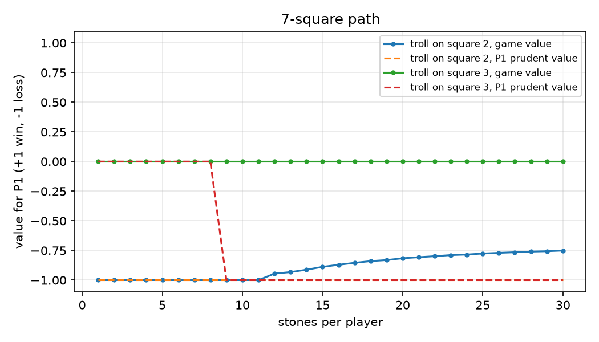

# Trolls & Castles

Solver and strategy tournament for a two-player game where both sides throw
stones at a troll to keep it away from their castle.

Every turn each player secretly picks how many stones to throw. The troll moves
one square towards whoever threw fewer. If the troll reaches your castle, or you
run out of stones at the wrong moment, you lose. The interesting part is that
moves are simultaneous, so the best strategy has to be random.

Game theory course project (Master 1, 2025-2026), done with Mohamed Ali Damergi.

## What it does

- Solves every state of the game exactly, using backward induction with memoisation
- Computes both the pure max-min value and the mixed Nash equilibrium of each
  state (a linear program per state, using SciPy/HiGHS)
- Plays 5 strategies against each other (equilibrium, prudent, adaptive, random,
  always-one) under the contest rules: 1000 games per match, 3/1/0 points
- Checked against the values worked out by hand in the course

## Results in short

- The symmetric game is a draw, but no deterministic strategy can guarantee it:
  from 9 stones on (7-square path), you must randomise.
- The equilibrium strategy wins every match, in all four contest configurations.
- The "safe" minimax strategy always throws 1 stone, so a simple adaptive
  bot spots it and beats it 1000 games to 0.
- A single extra stone (15 vs 14) moves the value from 0 to +0.53.

Details, tables and plots are in [docs/report.md](docs/report.md).



## Run it

```bash
pip install -r requirements.txt

python main.py solve --cells 7 --stones 15        # game value and optimal first move
python main.py match --p1 nash --p2 prudent --show
python main.py tournament --cells 15 --stones 30
python main.py curve --cells 7 --max-stones 30 --out curve.png

pytest
```

## Layout

```
troll/game.py         rules
troll/solver.py       backward induction, matrix-game LP
troll/strategies.py   the five strategies
troll/simulation.py   games, matches
main.py               command line
tests/                rules, course values, solver checks
docs/                 report, plots, tournament outputs
```
