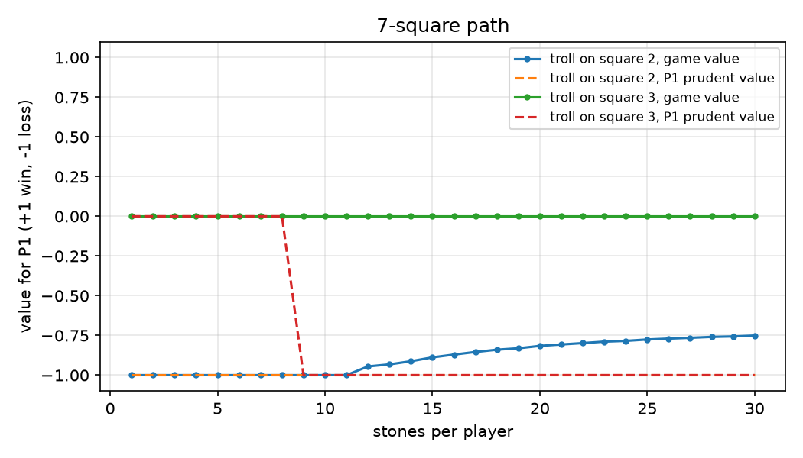
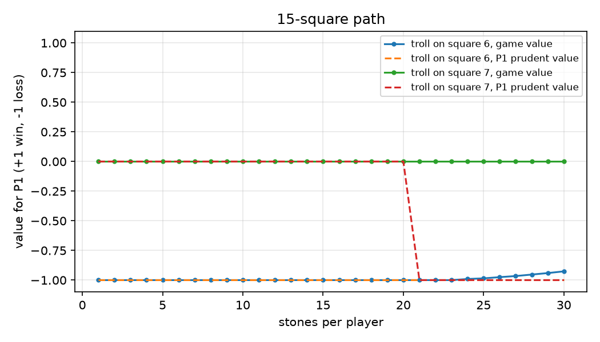

# Trolls & Castles: report

Game theory course, Master 1, 2025-2026.
Tanguy Vallot and Mohamed Ali Damergi.

## 1. The game

Two players defend castles at both ends of a path. A troll starts on the middle
square. Every turn both players secretly choose how many stones to throw at it
(at least one, at most what they have left). The troll moves one square towards
whoever threw fewer, or stays put on a tie.

The game ends when:

- the troll reaches a castle, and that castle's owner loses, or
- a player runs out of stones. The other player's remaining stones each push the
  troll one more square. The troll then walks to the nearest castle, and that
  castle's owner loses. If the troll ends on the middle square, the game is a draw.

The game is zero-sum: +1 if P1 wins, -1 if P2 wins, 0 for a draw. The contest
configurations are 7 squares with 15 or 30 stones, and 15 squares with 30 or 50 stones.

## 2. Model

A state is `(troll position, stones of P1, stones of P2)`. Every turn removes at
least one stone from each player, so the game is finite. All states can be
solved bottom-up, starting from the smallest stone counts (`troll/solver.py`).

In each state, the players face a small matrix game. Row `a1` and column `a2`
hold the value of the state reached after throws `(a1, a2)`. We compute three
numbers for every state:

| Table   | Definition | Meaning |
|---------|------------|---------|
| `lower` | max over a1 of min over a2 | best result P1 can **guarantee** with pure (deterministic) play |
| `upper` | min over a2 of max over a1 | the same for P2 |
| `value` | value of the matrix game with mixed strategies, solved by linear programming | the real value of the game (von Neumann's minimax theorem) |

They always satisfy `lower <= value <= upper`. When `lower = upper`, the state has
a saddle point and pure play is enough. When they differ, only a randomised
strategy can reach the value. The solver checks for a saddle point first and
calls the LP (SciPy/HiGHS) only when one is needed. The LP gives P1's optimal
mix, and its dual variables give P2's.

**Checks.** The course slides work out a few values by hand on a 5-square path,
and the solver matches all of them (see `tests/`). It also answers the question
the slides leave open: `V(4, 3, -1) = -0.5`. In that state the optimal play is a
50/50 mix between throwing 1 and 3 stones. With pure strategies, P1 can only
guarantee -1 and P2 can only guarantee 0.

**Correction from our first version.** Our original "Nash" strategy solved an LP
over the pure max-min values of the next states, not over their equilibrium
values. Its matrix therefore assumed that the opponent sees our throw before
answering, so the strategy behaved almost exactly like the prudent one. Our
first report concluded that the two strategies are equivalent; that was wrong.
This version solves the full recursion with mixed values.

## 3. What the values say

| Configuration | P1 prudent value | Game value | P2 prudent value |
|---|---|---|---|
| 7 squares, 15 stones each | -1 | 0 | +1 |
| 7 squares, 30 stones each | -1 | 0 | +1 |
| 15 squares, 30 stones each | -1 | 0 | +1 |
| 15 squares, 50 stones each | -1 | 0 | +1 |
| 7 squares, 15 stones, troll one square closer to P1 | -1 | -0.888 | 0 |
| 7 squares, 15 vs 14 stones | -1 | +0.525 | +1 |

- **The symmetric game is fair** (value 0), as expected. But in every contest
  configuration, deterministic play guarantees nothing: a player who always plays
  the "safe" move can be beaten by someone who knows it.
- **Above a threshold, randomising becomes necessary.** On 7 squares, pure play
  still guarantees a draw up to 8 stones and fails from 9 stones on. On 15 squares,
  the threshold is 21 stones.

- **Moving the troll one square** towards P1 loses the game for P1 when stones
  are scarce. With more stones, P1 gets real chances back by randomising: on
  7 squares the value rises from -1 to about -0.75 at 30 stones. In pure
  strategies it stays at -1, which is what our first report saw.
- **One extra stone matters a lot**: 15 against 14 stones gives P1 a value of +0.525.

## 4. Strategies

| Name | Behaviour |
|---|---|
| `prudent` | pure max-min move; on ties, throws the fewest stones |
| `nash` | samples its throw from the equilibrium mix of the current state |
| `one` | always throws one stone |
| `random` | uniform throw between 1 and its remaining stones |
| `adaptive` | throws one more than the opponent's average throw so far |

## 5. Tournament

We follow the contest rules: 1000 games per match, and a strategy keeps its
memory across the games of a match. The match winner gets 3 points, and each
side gets 1 point for a tie. Every strategy plays every other one from both seats.
Full outputs are in [`results/`](results/).

**7 squares, 15 stones** (P1 wins / P2 wins / draws, out of 1000):

| P1 \ P2 | prudent | nash | one | random | adaptive |
|---|---|---|---|---|---|
| prudent | 0 / 0 / 1000 | 228 / 641 / 131 | 0 / 0 / 1000 | 935 / 63 / 2 | 0 / 1000 / 0 |
| nash | 643 / 230 / 127 | 323 / 351 / 326 | 724 / 276 / 0 | 958 / 34 / 8 | 626 / 285 / 89 |
| adaptive | 1000 / 0 / 0 | 282 / 627 / 91 | 1000 / 0 / 0 | 480 / 340 / 180 | 0 / 0 / 1000 |

**Standings**

| Configuration | 1st | 2nd | 3rd |
|---|---|---|---|
| 7 squares, 15 stones | nash 24 | adaptive 18 | prudent / one 8 |
| 7 squares, 30 stones | nash 24 | random / adaptive 12 | prudent 8 |
| 15 squares, 30 stones | nash 24 | adaptive 12 | prudent / one 8 |
| 15 squares, 50 stones | nash 24 | adaptive 18 | prudent / one 8 |

The equilibrium strategy wins every match in every contest configuration.

- **`prudent` is easy to exploit.** In the symmetric game every throw has the
  same worst case, so it always throws 1. `adaptive` notices this after one game,
  throws 2 every turn and wins all 1000 games.
- **`adaptive` is in turn exploitable**, and it loses to `nash` about 63% of the
  time. Being predictable is the real weakness in a simultaneous game.
- **`nash` cannot be exploited**: on average it does at least as well as the game
  value against any opponent. It also wins whenever the opponent strays from
  the equilibrium.
- With the troll starting closer to P1, the seat decides almost everything.
  Even there, `nash` as P1 still beats `random` 730 to 244, while `prudent` only
  splits 501 / 499.

## 6. Conclusion

Minimax with memoisation solves the game exactly, but only for an opponent who
could read our mind. Because the throws are simultaneous, the right tool is the
mixed equilibrium: an LP at each state, chained by backward induction. The
resulting strategy is the only one that wins every match in the four contest
configurations. The
initial position and stock difference matter more than any strategy, and once
stones are plentiful, randomising is the only way to hold the fair value.
